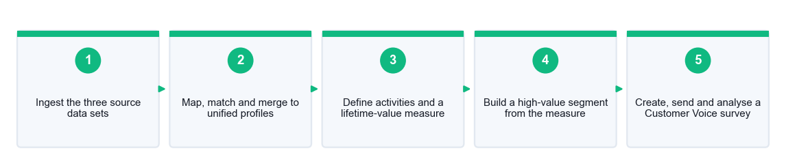
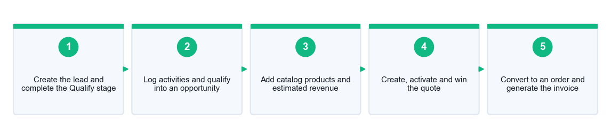
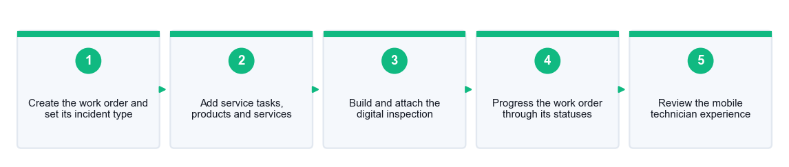
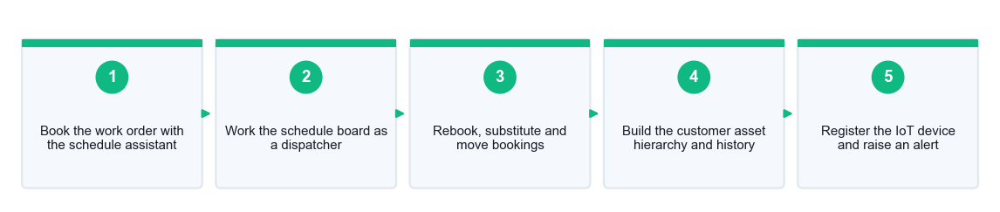

# Microsoft Dynamics 365 Fundamentals (CRM) (MB-910) — Learner Guide

**WSQ Course Code:** TGS-2023040481  |  **Conducted by:** Tertiary Infotech Academy Pte Ltd (UEN 201200696W)  |  **Version v6 · 1 September 2026**

## Contents

- [Introduction](#introduction)
- [Course Learning Outcomes](#course-learning-outcomes)
- [Skills Framework Alignment](#skills-framework-alignment)
- [Before You Start — Environment Setup](#before-you-start--environment-setup)
- [Topic 01 — Foundations of Dynamics 365 Customer Engagement Apps](#topic-01--foundations-of-dynamics-365-customer-engagement-apps)
  - [Lab 1 — Navigate Dynamics 365 and Explore Dataverse](#lab-1--navigate-dynamics-365-and-explore-dataverse)
- [Topic 02 — Shared Activities and Integration Options](#topic-02--shared-activities-and-integration-options)
  - [Lab 2 — Manage Customers, Activities and Reporting Views](#lab-2--manage-customers-activities-and-reporting-views)
- [Topic 03 — Dynamics 365 Customer Insights – Journeys](#topic-03--dynamics-365-customer-insights--journeys)
  - [Lab 3 — Build a Segment, an Email and a Customer Journey](#lab-3--build-a-segment-an-email-and-a-customer-journey)
- [Topic 04 — Customer Insights – Data and Customer Voice](#topic-04--customer-insights--data-and-customer-voice)
  - [Lab 4 — Unify Customer Data and Capture Feedback with Customer Voice](#lab-4--unify-customer-data-and-capture-feedback-with-customer-voice)
- [Topic 05 — Explore Dynamics 365 Sales](#topic-05--explore-dynamics-365-sales)
  - [Lab 5 — Run the Lead-to-Cash Cycle: Lead, Opportunity, Quote, Order](#lab-5--run-the-lead-to-cash-cycle-lead-opportunity-quote-order)
- [Topic 06 — Dynamics 365 Sales Capabilities and Related Apps](#topic-06--dynamics-365-sales-capabilities-and-related-apps)
  - [Lab 6 — Forecast the Pipeline and Evaluate Sales Insights](#lab-6--forecast-the-pipeline-and-evaluate-sales-insights)
- [Topic 07 — Explore Dynamics 365 Customer Service](#topic-07--explore-dynamics-365-customer-service)
  - [Lab 7 — Resolve a Case with Knowledge, Queues, SLAs and Entitlements](#lab-7--resolve-a-case-with-knowledge-queues-slas-and-entitlements)
- [Topic 08 — Customer Service Capabilities and Related Apps](#topic-08--customer-service-capabilities-and-related-apps)
  - [Lab 8 — Omnichannel, Supervisor Insights and Service Analytics](#lab-8--omnichannel-supervisor-insights-and-service-analytics)
- [Topic 09 — Explore Dynamics 365 Field Service](#topic-09--explore-dynamics-365-field-service)
  - [Lab 9 — Create and Complete a Work Order with an Inspection](#lab-9--create-and-complete-a-work-order-with-an-inspection)
- [Topic 10 — Field Service Scheduling Capabilities and Related Apps](#topic-10--field-service-scheduling-capabilities-and-related-apps)
  - [Lab 10 — Schedule Resources, Manage Assets and Connect IoT](#lab-10--schedule-resources-manage-assets-and-connect-iot)
- [Exam Focus — MB-910 Skills Measured](#exam-focus--mb-910-skills-measured)
- [Assessment](#assessment)
- [Glossary](#glossary)

## Introduction

This Learner Guide accompanies the WSQ course Microsoft Dynamics 365 Fundamentals (CRM) (MB-910) (TGS-2023040481), conducted by Tertiary Infotech Academy Pte Ltd (UEN 201200696W). It provides the detailed, step-by-step instructions for all ten hands-on labs, organised by the ten course topics, which together cover the four skill areas measured by Microsoft exam MB-910: Dynamics 365 Customer Insights, Sales, Customer Service and Field Service, plus the core customer engagement capabilities shared by all of them.

Use this guide alongside the course slides. The slide deck explains the concepts and shows each lab as a single workflow overview; THIS guide carries every step, every field value and every verification. Keep it open while you work — it is also one of the materials you may use during the open-book assessment.

Every lab is built around one continuing scenario: Contoso Coffee Singapore, a commercial coffee equipment supplier serving hospitality customers across Singapore. Working one scenario across all four apps is what makes the platform's shared Dataverse tangible: the account you create in Lab 2 is the same account that raises a case in Lab 7 and a work order in Lab 9.

## Course Learning Outcomes

- LO1: Develop strategies for implementing Microsoft Dynamics 365 CRM capabilities and utilising the tools to disseminate information
- LO2: Develop frameworks to define customer journeys for marketing on Microsoft Dynamics 365 CRM
- LO3: Manage strategies to optimise the deployment and performance of Dynamics 365 customer engagement apps
- LO4: Draw actionable insights from Dynamics 365 CRM data to evaluate team and service performance
- LO5: Review research outcomes and recommend investments in Dynamics 365 CRM tools and technologies

## Skills Framework Alignment

This course is aligned to the Skills Framework Technical Skill and Competency Customer Relationship Management (RET-RAN-4001-1.1).

| Reference | Ability / Knowledge |
|---|---|
| A1 | Develop and manage plans for implementing new CRM capabilities |
| A2 | Review research findings and recommend investments in CRM tools and technologies deployment |
| A3 | Manage and monitor optimisation of CRM tools and technologies |
| A4 | Draw and communicate insights from CRM data |
| A5 | Draw insights into team's performance and fine-tune sales processes |
| A6 | Utilise appropriate tools to share information and stay connected from anywhere |
| A7 | Develop and define customer journeys for marketing and remarketing |
| K1 | Organisation's CRM strategies |
| K2 | Limitations of CRM |
| K3 | Opportunities of CRM |
| K4 | Types of CRM technology and tools |
| K5 | Criteria for recommending investments in CRM tools and technologies |
| K6 | Criteria for improving existing CRM practices and programmes |
| K7 | Processes involved in monitoring optimisation of CRM tools and technologies |
| K8 | Methods for drawing and communicating insights from CRM data |
| K9 | Criteria for reviewing research findings related to CRM |

## Before You Start — Environment Setup

**What you need**

- A Microsoft Dynamics 365 environment. In class the trainer provides an account of the form training<N>@tertiaryinfotech.onmicrosoft.com in a shared tenant. Outside class, a free 30-day trial at https://trials.dynamics.com gives you every app used in these labs.
- A modern browser — Microsoft Edge or Google Chrome. Some panes (notably the Field Service booking requirements panel) do not work in older browsers.
- The lab mock data. Each lab has its own folder under labs/ containing the CSV files it needs and a printable instruction PDF.
- A note-taking file or the printed worksheet, for the values each lab asks you to record.

**The shared-tenant rules**

In class you share one Dynamics 365 organisation with the rest of the group, exactly as employees share their employer's tenant. Three rules follow from that, and they matter:

- Record your user name up to the @ symbol — this is your LAB ALIAS. Prefix or suffix every record you create with your initials or alias so you can always find your own work.
- Never enter real personally identifiable information (PII). All the mock data supplied uses example.sg and contososample.com addresses that cannot receive mail.
- Do not delete or edit records you did not create, and do not change environment-level settings unless a lab step explicitly tells you to.

**Conventions used in every lab**

- Menu paths are written as Area > Group > Item, matching the left navigation of the app.
- Field names appear exactly as they are labelled on the form.
- Values you type are given in quotes; '<your initials>' means substitute your own.
- Each lab ends with a 'Test it' check — complete it before moving on, and ask the trainer if it fails.
- Where a feature needs a licence your tenant may not have (Customer Insights – Data, Sales Insights premium, LinkedIn Sales Navigator, Omnichannel), the lab says so and gives you a documentation-based alternative that still meets the learning outcome.

**Importing the mock data**

Several labs begin by importing a CSV. The import path is the same every time:

1. Open the app and navigate to the table you are importing into — for example Sales Hub > Contacts.
2. On the command bar select Import from Excel (you may need the ellipsis '...' to see it).
3. Choose the CSV file from the lab's data folder and select Next.
4. Review the field mapping. Dynamics 365 maps columns whose names match; map the rest by hand.
5. Select Finish Import, then Track Progress to watch the import job. Refresh the view when it completes.

> **Note:** If an import fails, open the import job's Failures tab — it names the exact row and column that caused the problem. The most common causes are a lookup value that does not exist yet (create the parent record first) and a date in the wrong regional format.

## Topic 01 — Foundations of Dynamics 365 Customer Engagement Apps

CRM concepts · Power Platform · Microsoft Dataverse · the five CE apps · Copilot · navigation

**Key concepts**

- A customer is an entity you serve — Any entity receiving, consuming or purchasing a product or service — a business (account) or a person (contact).
- Customer engagement is emotional — The connection between customer and brand. Engaged customers buy more, stay longer and advocate — CRM exists to build that connection.
- CRM manages the whole relationship — One system of record for every interaction across marketing, sales, service and field operations — not just a contact list.
- Power Platform is the foundation — Dynamics 365 CE apps ARE model-driven Power Apps: Power Apps, Power Automate, Power BI, Power Pages and Copilot Studio all extend them.
- Dataverse is the single data store — All CE apps share one secure, governed Dataverse database — tables, columns, relationships, business rules and role-based security.
- Five core customer engagement apps — Customer Insights (Journeys + Data), Sales, Customer Service, Field Service and Project Operations — modular, licensed separately, sharing one Dataverse.
- Copilot is embedded everywhere — Natural-language AI inside each app: summarise records, draft emails, create work orders from email, build segments in plain English.
- Many ways in, one data set — Browser, mobile apps, Outlook, Teams, Power Pages portals — every entry point reads and writes the same Dataverse rows.

### Lab 1 — Navigate Dynamics 365 and Explore Dataverse

Maps to: Describe the foundations of Dynamics 365 customer engagement apps: Power Platform, Dataverse, the five CE apps and navigation.

Estimated time: 45 minutes.

**Goal**

An environment inventory table (environment name, type, region, Dataverse URL, installed CE apps, security roles) plus an annotated navigation map screenshot set. You will do this in 45 minutes using Power Platform admin center, make.powerapps.com, Dynamics 365 Sales Hub, Customer Service Hub, Dataverse.

**Scenario**

You are a new CRM analyst at Contoso Coffee Singapore. Before you can advise on CRM investment you must know what is actually deployed. Sign in to the Power Platform admin centre, identify the environment and its Dataverse database, open the Sales Hub and Customer Service Hub apps, and map how the five customer engagement apps share one data store. You finish by recording an environment inventory your team can act on.

**Workflow**

The five stages of this lab, in order:

*Lab 1 workflow — Sign in to the Power Platform admin center → Inspect the environment and its Dataverse database → Open the Sales Hub and switch apps from the app launcher → Explore Dataverse tables, columns and relationships → Record the environment inventory and navigation map*

**What you'll produce**

An environment inventory table (environment name, type, region, Dataverse URL, installed CE apps, security roles) plus an annotated navigation map screenshot set.   (Tools: Power Platform admin center, make.powerapps.com, Dynamics 365 Sales Hub, Customer Service Hub, Dataverse.)

**Mock data supplied**

- data/environment-inventory.csv — 9 rows, columns: Item, Value to record, Where to find it

> **Note:** All files are in labs/lab-01-navigate-dynamics-365-and-explore-dataverse/data/ and are also attached to the lab instruction PDF in that folder.

**Step-by-step**

1. Open a browser and go to https://admin.powerplatform.microsoft.com. Sign in with the trainer-provided Microsoft 365 account (training<N>@tertiaryinfotech.onmicrosoft.com). Record your user name up to the @ symbol — this is your lab alias and you will prefix every record you create with it.
2. Select Environments in the left navigation. Note the environment Name, Type (Production / Sandbox / Trial), Region and State. Open the environment and copy its Environment URL — this is your Dataverse organisation URL.
3. In the environment detail page, look at the Dataverse section: note the database version, language and currency. Record the Dataverse database size. This one database is shared by every Dynamics 365 customer engagement app in the environment.
4. Select Resources > Dynamics 365 apps. List which customer engagement apps are installed (Sales, Customer Service, Field Service, Customer Insights, Project Operations) and their installed status. This is the deployment baseline for your inventory.
5. Go to https://make.powerapps.com and confirm the correct environment is selected in the top-right environment picker. Select Tables in the left navigation, then set the filter to All to see every Dataverse table, not just custom ones.
6. Open the Account table. Review the Columns tab: note the account name, primary contact, and the ownership model. Then open the Relationships tab and find the one-to-many relationship from Account to Contact — this is how a company links to its people.
7. Open the Contact table and find the Company Name (parentcustomerid) column. Confirm it is a Lookup to Account. Record this relationship: Account 1 -> N Contact.
8. Return to https://make.powerapps.com and select Apps. Note that the Dynamics 365 apps (Sales Hub, Customer Service Hub) are listed as Model-driven app types — Dynamics 365 CE apps ARE model-driven Power Apps.
9. Open the Dynamics 365 Sales Hub app. Explore the left navigation: note the area switcher at the bottom-left (Sales / Activities / Settings) and the groups within the Sales area (Customers, Sales, Collateral, Performance).
10. Select the app launcher (the waffle icon, top-left) and switch to the Customer Service Hub. Confirm that the Accounts and Contacts you see are the SAME records you saw in Sales Hub — one Dataverse, many apps.
11. In either app, select the Settings gear > Advanced Settings > Security > Users to view the security roles applied to your account. Record which roles you hold (e.g. Salesperson, Customer Service Representative).
12. Complete the environment inventory table in your lab worksheet (data/environment-inventory.csv) with the values you recorded, and save your navigation screenshots as evidence.

**Test it**

You can state: the environment name and type, the Dataverse organisation URL, which CE apps are installed, at least two Dataverse tables and the Account-to-Contact relationship, and you can switch between two apps and show that the same Account record appears in both.

> **Note:** The printable instructions for this lab are in labs/lab-01-navigate-dynamics-365-and-explore-dataverse/lab-01-instructions.pdf.

---

## Topic 02 — Shared Activities and Integration Options

Accounts & contacts · activities · search & filters · views, charts and dashboards · Excel, Teams and Outlook integration

**Key concepts**

- Accounts and contacts model the customer — Account = an organisation (B2B); Contact = a person (B2C). Hybrid organisations use both, with contacts related to a parent account.
- Activities record every touch — Phone call, task, email, appointment, letter and fax — all roll up on the record's Timeline so anyone can see the full history.
- Filtering is quick, search is broad — Filter narrows the view you are already in; search finds records you cannot see. Two search tools: Search a View and Dataverse multi-table search.
- Advanced Find builds real queries — A visual query designer to define criteria across related tables, save the result as a personal view and share it with a team.
- Views, charts and dashboards stack — A view is a filtered list; a chart visualises a view and is interactive; a dashboard combines views, charts, iframes and web resources.
- Power BI goes further — For cross-source analytics beyond a single Dataverse environment — embedded dashboards, refreshed datasets, richer visuals.
- Excel two ways — Static worksheets snapshot the data; dynamic worksheets and Excel templates stay linked to Dataverse and refresh.
- Teams and Outlook bring D365 to you — Teams collaboration hub, file integration and embedded chat; the Dynamics 365 App for Outlook tracks emails, meetings and contacts to records.

### Lab 2 — Manage Customers, Activities and Reporting Views

Maps to: Describe shared activities and integration options: accounts and contacts, activities, search and filters, views, charts and dashboards.

Estimated time: 60 minutes.

**Goal**

An Account with 3 related Contacts, 4 completed/open activities on the timeline, a saved personal view, a chart, a personal dashboard, and a dynamic Excel export. You will do this in 60 minutes using Dynamics 365 Sales Hub, Dataverse, Advanced Find, Excel, Microsoft Teams, Outlook.

**Scenario**

Contoso Coffee Singapore is onboarding a new B2B customer. You create the account and its contacts, log the full set of activities on the timeline, then build the reporting layer your manager needs: a filtered personal view via Advanced Find, a chart from that view, and a dashboard combining both. Finally you export to Excel and confirm the Outlook and Teams integration points.

**Workflow**

The five stages of this lab, in order:

*Lab 2 workflow — Create the account and its related contacts → Log phone, task, email and appointment activities → Build a filtered personal view with Advanced Find → Create a chart and a personal dashboard from that view → Export to Excel and check Teams/Outlook integration*

**What you'll produce**

An Account with 3 related Contacts, 4 completed/open activities on the timeline, a saved personal view, a chart, a personal dashboard, and a dynamic Excel export.   (Tools: Dynamics 365 Sales Hub, Dataverse, Advanced Find, Excel, Microsoft Teams, Outlook.)

**Mock data supplied**

- data/accounts.csv — 3 rows, columns: Account Name, Main Phone, Website, Street 1, City, Postal Code, Country, Industry, Annual Revenue (SGD)
- data/contacts.csv — 3 rows, columns: First Name, Last Name, Job Title, Business Phone, Email, Company Name

> **Note:** All files are in labs/lab-02-manage-customers-activities-and-reporting-views/data/ and are also attached to the lab instruction PDF in that folder.

**Step-by-step**

1. Open the Dynamics 365 Sales Hub. In the left navigation under Customers, select Accounts, then choose New on the command bar.
2. Create the account using row 1 of data/accounts.csv: Account Name 'Marina Bay Roasters - <your initials>', Main Phone '+65 6555 0181', Website 'marinabayroasters.example.sg', Address 1: Street 1 '12 Marina Boulevard', City 'Singapore', ZIP/Postal Code '018980', Country/Region 'Singapore'. Select Save.
3. With the account open, find the Contacts sub-grid on the form (or the Related tab > Contacts). Select the + (New Contact) icon and create the three contacts from data/contacts.csv, ensuring Company Name is set to your new account each time.
4. Contact 1: First Name 'Priya', Last Name 'Raman', Job Title 'Procurement Manager', Business Phone '+65 6555 0182', Email 'priya.raman@marinabayroasters.example.sg'. Save and Close. Repeat for contacts 2 and 3 from the CSV.
5. Return to the account record and open the Timeline. Select the + icon > Phone Call. Set Subject to 'Discovery call - <your initials>', set the Call To field to Priya Raman, and choose Save and Close.
6. On the Timeline, hover over the phone call and select the check-mark icon to mark it complete, then select Close on the Close Phone Call dialog. Confirm the activity now shows as Closed.
7. Add a Task from the Timeline: Subject 'Send wholesale price list - <your initials>', Due date = 3 days from today. Save and Close. Leave this one open so you have both open and completed activities.
8. Add an Appointment from the Timeline: Subject 'On-site tasting session - <your initials>', set a Start Time next week and a 1-hour Duration, and add Priya Raman as a Required Attendee. Save and Close.
9. Add an Email activity from the Timeline: Subject 'Welcome to Contoso Coffee - <your initials>', To = Priya Raman. Note that you can save it as a draft without sending. Save and Close.
10. Test filtering versus search. In the Accounts list, use the column header filter on City to show only Singapore accounts. Then use the global search box at the top and search for 'Marina' — note it returns matches across multiple tables (accounts, contacts, activities). Record the difference between filter and search in your worksheet.
11. Open Advanced Find (the funnel icon on the command bar, or Settings > Advanced Find). Set Look for = Accounts. Add the criteria: City equals Singapore AND Created On is Last 7 Days. Select Results to preview.
12. In Advanced Find, choose Save As and name the view 'Singapore accounts this week - <your initials>'. This becomes a personal view available in the Accounts view selector.
13. Go to Accounts and switch the view selector to your saved personal view. On the command bar select Show Chart, then choose an existing chart such as Accounts by Industry. Note the chart is interactive: click a segment and the list filters to it.
14. Create your own chart: from the Accounts list select the chart pane, then New Chart. Set the legend (series) to Count of Account and the horizontal axis to City. Name it 'Accounts by city - <your initials>' and Save.
15. Build a dashboard. In the left navigation select Dashboards, then New > Dynamics 365 Dashboard, and choose a 2-column layout. Add one chart component (your new chart) and one list component (your saved personal view). Name it 'CRM overview - <your initials>' and Save, then Close.
16. Export to Excel. Return to Accounts with your personal view selected, choose Export to Excel > Dynamic Worksheet, select the columns to include and download. Open the file and note it keeps a live link back to Dataverse — a static worksheet would not.
17. Confirm the integration points: in Settings > Advanced Settings > Dynamics 365 App for Outlook, note the deployment status. In Microsoft Teams, note that the Dynamics 365 app can pin a record or view into a channel tab. Record both in your worksheet — no configuration change is required.

**Test it**

Your account shows 3 contacts and 4 timeline activities (one completed phone call, one open task, one appointment, one email). Your personal view returns the account, your chart renders from that view, your dashboard shows both the chart and the list, and your dynamic Excel export opens with the account row present.

> **Note:** The printable instructions for this lab are in labs/lab-02-manage-customers-activities-and-reporting-views/lab-02-instructions.pdf.

---

## Topic 03 — Dynamics 365 Customer Insights – Journeys

Marketing use cases · email marketing · segments and marketing lists · customer journeys · lead generation · forms and events

**Key concepts**

- Find the right leads and nurture them — Customer Insights – Journeys runs multi-channel campaigns that attract prospects and mature them into sales-ready leads.
- Real-time vs outbound marketing — Real-time reacts to signals as they happen (trigger-based); outbound runs planned, segment-based B2B campaigns on a schedule.
- Email is the core channel — The visual email designer adds text and graphics, styles the message, personalises with dynamic content and inserts tracked links.
- Segments group your audience — Demographic, firmographic, behavioural, static and combined audiences — dynamic segments recalculate as data changes.
- Marketing lists are the static cousin — A fixed membership list (static or dynamic query) carried over from the classic marketing model.
- A journey is the path you design — A flowchart of tiles — audience, messages, branches (if/then, split), waits and actions — that a contact travels through.
- Triggers start, continue and stop journeys — Custom, interaction and business triggers: Contact created, Email opened, Order placed — real-time reaction to behaviour.
- Leads, forms and events feed the funnel — Marketing forms capture leads on landing pages; event management handles planning, registration, sessions, speakers and follow-up.

### Lab 3 — Build a Segment, an Email and a Customer Journey

Maps to: Describe Dynamics 365 Customer Insights – Journeys: segments, email marketing, customer journeys, lead generation, forms and events.

Estimated time: 60 minutes.

**Goal**

A live segment of Singapore hospitality contacts, a published marketing email, a running customer journey with a branch, a marketing form on a landing page, and an event with a registration record. You will do this in 60 minutes using Dynamics 365 Customer Insights – Journeys, Dataverse, email designer, segment builder, event management.

**Scenario**

Contoso Coffee Singapore is launching a cold-brew range to its Singapore hospitality contacts. You build the targeting segment, design a marketing email with dynamic personalisation, wire both into a customer journey with a trigger and a conditional branch, then create the marketing form and event that capture the resulting leads. This is the full marketing framework the course's LO2 requires.

**Workflow**

The five stages of this lab, in order:

*Lab 3 workflow — Create the audience segment and check its membership → Design and personalise the marketing email → Build the journey with a trigger and a branch → Publish the journey and verify it goes live → Create the marketing form and the event registration*

**What you'll produce**

A live segment of Singapore hospitality contacts, a published marketing email, a running customer journey with a branch, a marketing form on a landing page, and an event with a registration record.   (Tools: Dynamics 365 Customer Insights – Journeys, Dataverse, email designer, segment builder, event management.)

**Mock data supplied**

- data/marketing-contacts.csv — 12 rows, columns: First Name, Last Name, Email, Company Name, City, Industry, Consent

> **Note:** All files are in labs/lab-03-build-a-segment-an-email-and-a-customer-journey/data/ and are also attached to the lab instruction PDF in that folder.

**Step-by-step**

1. Open the Dynamics 365 Customer Insights – Journeys app. Use the area switcher at the bottom of the left navigation to confirm you are in the Real-time journeys area (not Outbound marketing).
2. Import the marketing contacts first. In the Sales Hub or Customer Service Hub, select Contacts, then Import from Excel on the command bar, and upload data/marketing-contacts.csv. Map the columns to First Name, Last Name, Email, Company Name, City and Industry, and complete the import.
3. Back in Customer Insights – Journeys, under Audience select Segments, then New segment > Build your own.
4. Name the segment 'SG hospitality contacts - <your initials>'. Set the target audience to Contact. Add the condition: Contact.City equals Singapore. Select Add attribute again and add AND Contact.Industry contains Hospitality.
5. Try the Copilot query assist if it is enabled: select the copilot icon and type 'contacts in Singapore who work in hospitality'. Compare the generated definition with the one you built by hand.
6. Select Save, then Go live (or Publish). Wait for the segment status to change to Live, then open the Members tab and confirm the expected contacts appear. Record the member count in your worksheet.
7. Under Channels select Emails, then + New. Choose a simple layout (or Start from blank).
8. Set the email Name to 'Cold brew launch - <your initials>'. Set the Subject line to 'Introducing our new cold brew range'. In the designer, drag a Text element onto the canvas and write a short opening paragraph.
9. Add personalisation: place your cursor in the greeting line, select the Personalization button, choose Contact > First Name, and insert it. Set a fallback value of 'there' so the email still reads correctly if the field is blank.
10. Drag a Button element onto the canvas. Set its text to 'Reserve a tasting' and set the link to your event or landing page URL (you will create the form in a later step — a placeholder URL is fine now).
11. Complete the required compliance elements: confirm the email includes a physical postal address and an unsubscribe/preference-centre link. Real-time marketing blocks publishing without them.
12. Select Check content (or Preview) to validate the email, fix any errors reported, then select Ready to send / Publish. Confirm the status shows Ready to send.
13. Under Engagement select Journeys, then + New journey. Choose Segment-based (start when a contact joins a segment), and select your 'SG hospitality contacts' segment as the audience. Name the journey 'Cold brew launch journey - <your initials>'.
14. On the journey canvas, the audience tile is already placed. Select the + below it and add your 'Cold brew launch' email as the first message tile.
15. Select + again and add a Wait tile. Set it to wait 2 days (or 5 minutes if you want to observe the journey run during the class).
16. Select + and add an If/then branch. Set the condition to 'Email was opened' on your cold-brew email. This creates a Yes path and a No path.
17. On the Yes path add an Action tile > Create a lead (or Sales activity), so an engaged contact becomes a lead for the sales team. On the No path add a second Message tile with a follow-up reminder email (you may reuse the same email for the lab).
18. Select Publish (Go live) on the command bar. Confirm the journey status changes to Live and note the audience count it reports.
19. Create the lead-capture form. Under Channels select Forms, then + New form. Choose the Landing page form type. Drag in the First Name, Last Name and Email fields, plus a Submit button. Name it 'Cold brew tasting signup - <your initials>' and select Save, then Publish. Copy the hosted form URL.
20. Create the event. Switch the area to Events (or open the Events app area). Select Events > + New. Set Name 'Cold brew tasting - <your initials>', a Start and End date next month, Venue 'Marina Bay Roasters', and set the Event registration to allow anonymous registration. Save.
21. On the event record, open the Agenda tab and add one Session: Name 'Cold brew method masterclass', with a start time inside the event window and a speaker of your choice. Save.
22. Publish the event (set the status to Live) and confirm the event website URL is generated. Record the segment member count, journey status and event URL in your worksheet.

**Test it**

Your segment is Live with a non-zero member count; your email passes the content check and is Ready to send; your journey is Live and shows the audience -> email -> wait -> branch structure on the canvas; your form is published with a URL; and your event is Live with one session.

> **Note:** The printable instructions for this lab are in labs/lab-03-build-a-segment-an-email-and-a-customer-journey/lab-03-instructions.pdf.

---

## Topic 04 — Customer Insights – Data and Customer Voice

Unified customer profiles · data ingestion, unification, enrichment · measures and segments · survey feedback management

**Key concepts**

- One profile from many sources — Customer Insights – Data ingests CRM, ERP, web, loyalty and point-of-sale data and unifies it into a single customer profile (a CDP).
- The unification pipeline — Ingest → map → match → merge → build the unified profile — deduplicating the same person across systems.
- Activities and relationships add depth — Define which ingested tables are activities (purchases, tickets, web visits) and how tables relate to the unified profile.
- Enrichment adds outside data — Brand affinity, interests, demographics and address enrichment extend the profile beyond what you collected.
- Measures are the KPIs — Customer-level (lifetime value per customer) or business-level (total revenue) calculations you can segment and report on.
- Segments feed activation — Segments built here flow into Journeys, Sales and Power BI to drive campaigns and prioritisation.
- Customer Voice captures the feedback loop — Enterprise feedback management — design surveys, distribute by email/link/QR/embed, and analyse satisfaction and NPS.
- Feedback drives decisions — Survey responses land in Dataverse, can trigger journeys and alerts, and appear on service and marketing dashboards.

### Lab 4 — Unify Customer Data and Capture Feedback with Customer Voice

Maps to: Describe Dynamics 365 Customer Insights – Data and Dynamics 365 Customer Voice: unified profiles, measures, segments and enterprise feedback management.

Estimated time: 45 minutes.

**Goal**

A unified customer profile set from three sources, a customer lifetime-value measure, a high-value segment, and a published Customer Voice survey with a satisfaction metric. You will do this in 45 minutes using Dynamics 365 Customer Insights – Data, Dataverse, Dynamics 365 Customer Voice, Power BI.

**Scenario**

Contoso's loyalty data, e-commerce orders and CRM contacts describe the same people under different keys. You walk the Customer Insights – Data unification pipeline to produce one profile per customer, define a lifetime-value measure and a high-value segment, then build and distribute a Customer Voice satisfaction survey and read the results. This gives you the customer insight LO4 asks you to draw.

**Workflow**

The five stages of this lab, in order:

*Lab 4 workflow — Ingest the three source data sets → Map, match and merge to unified profiles → Define activities and a lifetime-value measure → Build a high-value segment from the measure → Create, send and analyse a Customer Voice survey*

**What you'll produce**

A unified customer profile set from three sources, a customer lifetime-value measure, a high-value segment, and a published Customer Voice survey with a satisfaction metric.   (Tools: Dynamics 365 Customer Insights – Data, Dataverse, Dynamics 365 Customer Voice, Power BI.)

**Mock data supplied**

- data/ci-crm-contacts.csv — 8 rows, columns: ContactId, FullName, Email, Phone, City, SignupDate
- data/ci-loyalty.csv — 6 rows, columns: LoyaltyId, FullName, Email, Phone, Tier, PointsBalance
- data/ci-ecommerce-orders.csv — 10 rows, columns: OrderId, Email, OrderDate, OrderAmount, Channel

> **Note:** All files are in labs/lab-04-unify-customer-data-and-capture-feedback-with-custom/data/ and are also attached to the lab instruction PDF in that folder.

**Step-by-step**

1. Open Dynamics 365 Customer Insights – Data (https://home.ci.dynamics.com). If your tenant has no Customer Insights licence, use the guided demo environment or the trainer's shared environment — the pipeline stages are identical.
2. Select Data > Data sources > Add data source. Choose Text/CSV (or Upload file) and import data/ci-crm-contacts.csv. Name the source 'CRM contacts'. Review the inferred column data types and set ContactId as a text key.
3. Repeat the import for data/ci-loyalty.csv (name it 'Loyalty') and data/ci-ecommerce-orders.csv (name it 'Ecommerce orders'). You now have three sources describing overlapping people under different identifiers.
4. Select Data > Unify > Source fields (Map). Choose the tables to unify: CRM contacts and Loyalty. For each, select the primary key (ContactId, LoyaltyId) and map the shared semantic fields: FullName -> Person.Name, Email -> Person.Email, Phone -> Person.Phone.
5. Move to the Duplicate records step. For the CRM contacts table, add a deduplication rule on Email (Exact match) so the same email is never counted twice. Run it and review how many duplicates were collapsed.
6. Move to the Match conditions step. Set CRM contacts as the primary table. Create a match rule: CRM contacts.Email = Loyalty.Email, Exact match, normalised to lower case. Add a second, lower-precision rule on FullName + Phone as a fallback.
7. Move to the Merge (Unified customer fields) step. Where both sources supply a name, set the winner order to prefer CRM contacts. Exclude any field you do not want on the profile. Then select Save and Run to build the unified profiles.
8. When the run finishes, select Customers and open one unified profile. Confirm you can see the merged attributes and the source records that contributed to it. Record the total unified profile count versus the sum of the source rows — the difference is what unification removed.
9. Select Data > Activities > New activity. Choose the Ecommerce orders table, set the primary key to OrderId, set the relationship to the unified customer, set the Activity type to Purchase, and set the timestamp field to OrderDate and the value field to OrderAmount. Run the activity.
10. Select Insights > Measures > New > Build your own. Add the Ecommerce orders OrderAmount field, choose the Sum aggregation, and set the dimension to Customer ID so the result is per-customer. Name the measure 'Customer lifetime value - <your initials>' and Run it.
11. Select Insights > Segments > New > Build your own. Add the condition: your 'Customer lifetime value' measure is greater than 500. Name the segment 'High value customers - <your initials>', Save and Run, then record the member count.
12. Now capture feedback. Open Dynamics 365 Customer Voice (https://customervoice.microsoft.com) and select New project > From blank (or use the Customer satisfaction template).
13. Name the project 'Cold brew satisfaction - <your initials>'. In the survey designer add: (1) a Rating question 'How satisfied were you with your order?' using a 5-point scale, (2) a Net Promoter Score question, and (3) a free-text question 'What could we do better?'.
14. Apply survey best practice: keep it short, order the questions logically, and set clear expectations in the invitation text. Use Preview to test the survey on desktop and mobile before you distribute it.
15. Select Send. Review the four distribution options — Email, Link, QR code and Embed. Choose Link, copy the survey URL, and submit at least three responses yourself using different rating values so you have data to analyse.
16. Open the Report tab. Read the satisfaction metric summary and the NPS breakdown into Promoters, Passives and Detractors. Note where the responses are stored — the survey response is a Dataverse row, so it can trigger a journey or appear on a service dashboard.
17. Record in your worksheet: unified profile count, lifetime-value measure result for one customer, high-value segment size, and your survey's average satisfaction score and NPS.

**Test it**

You can show a unified profile that merges at least two source records, a lifetime-value measure with a per-customer result, a high-value segment with a member count, and a Customer Voice report showing an average satisfaction score and an NPS from at least three responses.

> **Note:** The printable instructions for this lab are in labs/lab-04-unify-customer-data-and-capture-feedback-with-custom/lab-04-instructions.pdf.

---

## Topic 05 — Explore Dynamics 365 Sales

Sales use cases · the sales lifecycle · leads and qualification · opportunity management · quotes, orders, invoices · business process flows · sales accelerator

**Key concepts**

- The sales lifecycle has five stages — Qualify → Develop → Propose → Close → (Won/Lost). Dynamics 365 Sales guides sellers through each with a business process flow.
- Leads test viability — A lead is an unqualified prospect. Qualification gathers information, contacts them and decides: qualify or disqualify.
- Qualifying creates the records — Qualifying a lead can create an account, a contact and an opportunity, then closes the lead as Qualified.
- Opportunities are potential revenue — Estimated revenue, close date, products, stakeholders, competitors and a probability — the deal you are working.
- Quote → Order → Invoice — The quote prices products for the customer; the order is their commitment to buy; the invoice is the request for payment.
- Business process flows guide the work — Stages and steps at the top of the form enforce the organisation's process — the Lead to Opportunity Sales Process is the default.
- The product catalog prices everything — Unit groups, products, price lists and discount lists produce consistent, controlled pricing on quotes and orders.
- Sales accelerator focuses the seller — A prioritised work list, sequences of consecutive activities, and multi-channel engagement (call, email, SMS, LinkedIn) in one workspace.

### Lab 5 — Run the Lead-to-Cash Cycle: Lead, Opportunity, Quote, Order

Maps to: Explore Dynamics 365 Sales: lead qualification, opportunity management, quotes, orders and invoices, and business process flows.

Estimated time: 60 minutes.

**Goal**

A qualified lead, an opportunity with product line items and estimated revenue, an activated and won quote, a sales order and an invoice — with the business process flow advanced to Close. You will do this in 60 minutes using Dynamics 365 Sales Hub, Dataverse, business process flows, product catalog, quotes, orders, invoices.

**Scenario**

Suzanne Burke of Contoso - Washington has enquired about new espresso equipment. You take that enquiry through the entire sales lifecycle: capture the lead, work the Lead to Opportunity business process flow, qualify it into an opportunity, add products from the catalog, generate a quote, activate and win it, convert to an order and raise the invoice. This is the LO1/LO3 backbone of the course.

**Workflow**

The five stages of this lab, in order:

*Lab 5 workflow — Create the lead and complete the Qualify stage → Log activities and qualify into an opportunity → Add catalog products and estimated revenue → Create, activate and win the quote → Convert to an order and generate the invoice*

**What you'll produce**

A qualified lead, an opportunity with product line items and estimated revenue, an activated and won quote, a sales order and an invoice — with the business process flow advanced to Close.   (Tools: Dynamics 365 Sales Hub, Dataverse, business process flows, product catalog, quotes, orders, invoices.)

**Mock data supplied**

- data/leads.csv — 4 rows, columns: Topic, First Name, Last Name, Job Title, Business Phone, Email, Company Name, City, Est. Budget (SGD), Purchase Timeframe
- data/products.csv — 5 rows, columns: Product ID, Name, Unit Group, Default Unit, List Price (SGD), Description

> **Note:** All files are in labs/lab-05-run-the-lead-to-cash-cycle-lead-opportunity-quote-or/data/ and are also attached to the lab instruction PDF in that folder.

**Step-by-step**

1. Open the Dynamics 365 Sales Hub. Under Sales in the left navigation select Leads, then choose the My Open Leads view and select New on the command bar.
2. Create the lead from row 1 of data/leads.csv: Topic 'Looking for New Equipment - <your initials>', First Name 'Suzanne', Last Name 'Burke', Job Title 'CFO', Business Phone '888 555-8715', Email 'suzanne@contososample.com', Company Name 'Contoso - Washington'. Select Save and leave the record open.
3. Note the Lead to Opportunity Sales Process business process flow across the top of the form. Select the Qualify stage to open its flyout and complete it: Purchase Timeframe 'This Quarter', Estimated Budget '25000', Purchase Process 'Individual', Identify Decision Maker 'Completed'.
4. Scroll to the Timeline in the middle of the form. Select the + icon and choose Phone Call. Set the Subject to 'Initial phone call - <your initials>' and leave the other fields as they are. Select Save and Close.
5. On the Timeline, hover over the phone call activity and select the check-mark icon to close it, then select Close on the dialog. The activity now shows as Closed — a completed qualification touch.
6. On the command bar select Qualify. Dynamics 365 creates the related Account, Contact and Opportunity records and advances the business process flow to the Develop stage. If prompted about creating records, accept the defaults.
7. You are now on the new Opportunity. Confirm the Contact is Suzanne Burke and the Account is Contoso - Washington. Set the Est. Close Date to the end of next month and the Purchase Timeframe to This Quarter. Save.
8. Add products. On the opportunity, open the Product Line Items sub-grid (Products tab) and select + New Opportunity Product. Choose Existing Product, pick a product from the catalog, set Quantity to 2, and Save and Close. Add a second line item the same way.
9. If your environment has no product catalog entries, create them first: Settings > Advanced Settings > Product Catalog > Products, and add the two items from data/products.csv with the Default Price List. Publish each product before it can be added to an opportunity.
10. Note that the opportunity's Est. Revenue is now calculated from the line items (System Calculated). Switch it to User Provided and enter 25000 if you want to override it — record which method your organisation would use and why.
11. Complete the Develop stage of the business process flow: set Identify Stakeholders and Identify Competitors to Completed. Open the Related tab and add one Stakeholder (Suzanne Burke, role Decision Maker) and one Competitor.
12. Advance to the Propose stage. On the command bar select Create Quote (or, from the Quotes sub-grid, + New Quote). The quote inherits the account, contact, price list and product line items from the opportunity.
13. On the quote, set the Name to 'Espresso equipment quote - <your initials>', confirm the line items carried across, and check the totals: Detail Amount, Discount, Pre-Freight Amount, Freight Amount and Total Amount. Save.
14. Select Activate Quote on the command bar. The quote becomes read-only — this is the version you would send to the customer. Note that you must Revise the quote to change it, which creates a new revision.
15. Select Create Order (or Close Quote as Won). On the Create Order dialog, tick Close Opportunity and set the status. This converts the quote into a Sales Order and marks the opportunity Won.
16. On the new Order, confirm the line items and Total Amount carried across. Set the Requested Delivery Date to two weeks from today. Save. Note the Order is the customer's commitment to buy.
17. Select Create Invoice on the order command bar. On the Invoice, confirm the line items and total. Note the Due Date field. Save.
18. Mark the invoice as paid: on the command bar select Invoice Paid, and choose Complete (paid in full) rather than Partial. Record the difference between the two options in your worksheet.
19. Return to the Opportunity and confirm the business process flow has reached Close and the opportunity status is Won with the actual revenue recorded. Take a screenshot of the full record chain as evidence.

**Test it**

You can trace one unbroken chain: Lead (Qualified) -> Opportunity (Won) -> Quote (Won) -> Order -> Invoice (Paid), with the same two product line items and totals carried through, and the Lead to Opportunity business process flow advanced to the Close stage.

> **Note:** The printable instructions for this lab are in labs/lab-05-run-the-lead-to-cash-cycle-lead-opportunity-quote-or/lab-05-instructions.pdf.

---

## Topic 06 — Dynamics 365 Sales Capabilities and Related Apps

Sales pipeline and forecasting · Sales Insights (standard vs premium) · LinkedIn Sales Navigator · the Sales mobile app · Microsoft 365 Copilot for Sales

**Key concepts**

- A forecast predicts the period — Sales forecasting projects revenue for a time period from the pipeline, rolled up the sales hierarchy with commit/best-case categories.
- Pipeline is the leading indicator — The pipeline chart plots open opportunities by estimated close date, colour-coded by score and sized by deal value.
- Sales Insights is AI for sellers — Relationship analytics, predictive lead and opportunity scoring, conversation intelligence and the Assistant's actionable cards.
- Standard vs premium matters — Included: Assistant, auto capture, email engagement, sequences. Premium (extra licence): relationship analytics, predictive scoring, conversation intelligence, notes analysis.
- LinkedIn Sales Navigator adds the person — Embedded lead and account controls: headline, news, icebreakers, TeamLink introductions, related leads and job-change alerts.
- Mobile is for the field seller — Plan the day, prepare for meetings, capture post-meeting notes by voice, and join online meetings from a phone.
- Copilot for Sales bridges M365 and CRM — Works inside Outlook and Teams: summarise emails and meetings, draft replies, and save CRM updates without opening Dynamics 365.
- Analytics answer the investment question — Forecast accuracy, win rates and pipeline coverage are the evidence for recommending CRM tool investment.

### Lab 6 — Forecast the Pipeline and Evaluate Sales Insights

Maps to: Describe Dynamics 365 Sales capabilities and related apps: pipeline and forecasting, Sales Insights standard vs premium, LinkedIn Sales Navigator, the mobile app and Copilot for Sales.

Estimated time: 45 minutes.

**Goal**

A pipeline chart and forecast for the current period, a sales accelerator work list with a sequence applied, a completed standard-vs-premium feature comparison, and a one-page investment recommendation. You will do this in 45 minutes using Dynamics 365 Sales Hub, Sales Insights, forecasting, sales accelerator, LinkedIn Sales Navigator, Copilot for Sales, Power BI.

**Scenario**

Your sales director wants to know whether to buy the Sales Insights premium add-on. You build the pipeline view and a forecast, work the sales accelerator list, examine which Sales Insights features are included versus licensed, review the LinkedIn Sales Navigator and mobile experiences, and produce a written investment recommendation — exactly the evidence LO5 requires.

**Workflow**

The five stages of this lab, in order:

*Lab 6 workflow — Import the pipeline data and open the pipeline chart → Configure and read a sales forecast → Work the sales accelerator list and apply a sequence → Compare Sales Insights standard vs premium features → Write the investment recommendation*

**What you'll produce**

A pipeline chart and forecast for the current period, a sales accelerator work list with a sequence applied, a completed standard-vs-premium feature comparison, and a one-page investment recommendation.   (Tools: Dynamics 365 Sales Hub, Sales Insights, forecasting, sales accelerator, LinkedIn Sales Navigator, Copilot for Sales, Power BI.)

**Mock data supplied**

- data/opportunities.csv — 8 rows, columns: Topic, Account, Est. Revenue (SGD), Est. Close Date, Rating, Probability, Sales Stage
- data/sales-insights-comparison.csv — 10 rows, columns: Feature, Standard (included), Premium (licensed), Business value, Needed by us? (Y/N)

> **Note:** All files are in labs/lab-06-forecast-the-pipeline-and-evaluate-sales-insights/data/ and are also attached to the lab instruction PDF in that folder.

**Step-by-step**

1. Open the Dynamics 365 Sales Hub. Import data/opportunities.csv into the Opportunity table (Opportunities > Import from Excel) so you have a pipeline to analyse. Map Topic, Account, Est. Revenue, Est. Close Date and Rating.
2. Under Performance in the left navigation select Sales Pipeline (or open the Sales Manager dashboard). Read the pipeline chart: opportunities plotted by estimated close date, colour-coded by rating and sized by deal value.
3. Change the chart's time filter to This Quarter, then Next Quarter, and note how pipeline coverage changes. Record the total open pipeline value for each period in your worksheet.
4. Open Forecasts (Performance > Forecasts). If a forecast is already configured, open it. If not, go to App Settings (or Sales Insights settings) > Forecast configuration > New, choose the Org chart forecast template, set the fiscal period to the current quarter, and set the roll-up entity to Opportunity.
5. In the forecast configuration, review the forecast categories — Pipeline, Best Case, Committed, Won and Omitted — and confirm which opportunity field drives them. Activate the forecast.
6. Open the activated forecast grid. Read the columns for each seller: Quota, Committed, Best Case, Pipeline and Won. Drill into one seller's row to see the underlying opportunities. Adjust one value and note that the adjustment is tracked separately from the system roll-up.
7. Record the forecast accuracy question in your worksheet: what would you compare (forecast committed vs actual won, by period) to prove the forecast is trustworthy?
8. Open the sales accelerator work list: in the left navigation select Sales accelerator (or My Work > Sales accelerator). If it is not enabled, enable it under App Settings > Sales accelerator and choose the record types to include.
9. Review the prioritised work list. Note the up-next widget, the record context and the multi-channel action buttons (call, email, SMS, LinkedIn message) available without leaving the workspace.
10. Create a sequence: App Settings > Sequences > New sequence. Name it 'New lead follow-up - <your initials>'. Add these steps in order: (1) Phone call, (2) Wait 1 day, (3) Send email, (4) Wait 2 days, (5) LinkedIn connection request. Activate the sequence.
11. Connect the sequence to a record: open one of your imported leads or opportunities, select Connect sequence on the command bar, and choose your sequence. Confirm the steps now appear in the seller's up-next widget.
12. Examine Sales Insights. Open App Settings > Sales Insights (or Settings > Sales Insights). List which features are switched on and which report that they require a premium licence.
13. Complete the comparison table in data/sales-insights-comparison.csv. Standard (included with Sales Enterprise): Assistant, auto capture, email engagement, sequences. Premium (separate licence): Assistant with Studio, auto capture premium, relationship analytics, predictive lead scoring, predictive opportunity scoring, notes analysis, conversation intelligence, who-knows-whom.
14. Open one opportunity and look at the Assistant cards in the right pane (or the Up next widget). Note what each card is telling the seller to do and where the signal came from.
15. Review the LinkedIn Sales Navigator controls. On a lead or contact form, note where the LinkedIn Sales Navigator Lead control would appear and what it surfaces: top card, news/icebreakers, connections (get introduced), related leads. On an account, the Account control adds recommended leads. If your tenant has no Sales Navigator licence, review the Microsoft documentation and record the capabilities.
16. Review the mobile experience. Install or open the Dynamics 365 Sales mobile app (or use the documentation walkthrough) and note the four seller scenarios it optimises: plan your day, prepare for meetings, capture post-meeting notes by voice, and join online meetings.
17. Review Microsoft 365 Copilot for Sales: note that it works inside Outlook and Teams to summarise email threads and meetings, draft replies, and save CRM updates without opening Dynamics 365. Record which of your team's tasks it would remove.
18. Write your recommendation in data/investment-recommendation.md (a template is provided): state the business problem, the pipeline and forecast evidence you gathered, the standard-vs-premium gap, the licence cost implication, and a clear recommend / do-not-recommend with three supporting reasons.

**Test it**

You can show the pipeline chart with a stated total value, an activated forecast with roll-up columns, an active sequence connected to at least one record, a completed standard-vs-premium comparison table, and a one-page written investment recommendation with three supporting reasons.

> **Note:** The printable instructions for this lab are in labs/lab-06-forecast-the-pipeline-and-evaluate-sales-insights/lab-06-instructions.pdf.

---

## Topic 07 — Explore Dynamics 365 Customer Service

Service use cases · the case lifecycle · SLAs and entitlements · workload management, queues and routing · business process flows · knowledge management

**Key concepts**

- Cases are the unit of service work — A case records a customer issue from creation through investigation to resolution, with every interaction on its timeline.
- The case lifecycle is Create → Assign → Investigate → Resolve — The Phone to Case business process flow guides agents through Identify, Research and Resolve.
- Cases arrive many ways — Manually by an agent, automatically by record-creation rules from email/social/IoT, or by a customer through a portal or bot.
- Queues hold and distribute work — Cases sit in queues; agents pick or are assigned items. Routing rules send each case to the right queue or agent.
- Basic vs unified routing — Basic routing uses rule sets (e.g. Gold/Silver/Bronze); unified routing adds skills-based, AI-driven work distribution across channels.
- SLAs put the clock on service — Service Level Agreements define first-response and resolution targets, with warning and failure actions when time runs out.
- Entitlements define what is covered — How much support a customer has bought — by hours or number of cases, per channel, with a term and remaining balance.
- Knowledge articles scale the answer — Authored, versioned, translated and published articles agents attach to cases and customers self-serve from the portal.

### Lab 7 — Resolve a Case with Knowledge, Queues, SLAs and Entitlements

Maps to: Explore Dynamics 365 Customer Service: the case lifecycle, SLAs and entitlements, queues and routing, business process flows and knowledge management.

Estimated time: 60 minutes.

**Goal**

A published knowledge article, a case routed through a queue with an SLA and an entitlement applied, advanced through all three BPF stages and resolved with the article linked. You will do this in 60 minutes using Dynamics 365 Customer Service Hub, Dataverse, knowledge management, queues, routing rules, SLAs, entitlements.

**Scenario**

Alpine Ski House has received a damaged espresso machine. You author and publish the knowledge article that answers it, create the case, route it through a queue, watch the SLA clock, apply an entitlement, work the Phone to Case business process flow, attach the article and resolve the case. This is the complete service lifecycle behind LO1 and LO3.

**Workflow**

The five stages of this lab, in order:

*Lab 7 workflow — Author and publish the knowledge article → Create the case and set its customer and origin → Route it to a queue and apply the SLA and entitlement → Work the Phone to Case BPF and attach the article → Resolve the case and check the resolution record*

**What you'll produce**

A published knowledge article, a case routed through a queue with an SLA and an entitlement applied, advanced through all three BPF stages and resolved with the article linked.   (Tools: Dynamics 365 Customer Service Hub, Dataverse, knowledge management, queues, routing rules, SLAs, entitlements.)

**Mock data supplied**

- data/cases.csv — 5 rows, columns: Case Title, Customer, Contact, Origin, Priority, Case Type, Subject, Description
- data/knowledge-articles.csv — 5 rows, columns: Title, Keywords, Subject, Summary

> **Note:** All files are in labs/lab-07-resolve-a-case-with-knowledge-queues-slas-and-entitl/data/ and are also attached to the lab instruction PDF in that folder.

**Step-by-step**

1. Open the Dynamics 365 Customer Service Hub. In the left navigation, switch the area to Service and select Knowledge Articles, then choose New on the command bar.
2. Author the article using row 1 of data/knowledge-articles.csv: Title 'Item Broken on Arrival - <your initials>', Keywords 'damaged, broken, shipping, replacement'. In the Content tab write the resolution steps: inspect and photograph the damage, log the courier reference, raise a replacement within 48 hours, and arrange collection of the damaged unit.
3. Save the article. Note the Article Public Number generated and the article's status (Draft) and stage on the knowledge lifecycle: Author -> Review -> Publish.
4. Open the Summary tab and set the Language. Then select Publish on the command bar. Set Publish Status to Published, choose to publish immediately, and confirm. Verify the article status is now Published — only published articles can be found by agents and customers.
5. Create the case. Select Cases from the Service section of the left navigation, then New Case on the command bar.
6. Complete the case from row 1 of data/cases.csv: Case Title 'Item arrived Damaged - <your initials>', Customer 'Alpine Ski House' (or Marina Bay Roasters if Alpine Ski House does not exist in your environment), Origin 'Phone', Priority 'High'. Select Save and leave the record open.
7. Examine the SLA. On the case form open the Related tab > SLA KPI Instances (or look for the First Response By and Resolve By fields on the form header). Note the countdown timer and the target time. If no SLA is applied, create one: Advanced Settings > Service Management > Service Level Agreements > New, add a First Response KPI with a 1-hour target, activate it and set it as the default.
8. Apply an entitlement. Open the Related tab > Entitlements on the customer account, or create one: Service Management > Entitlements > New, set the Customer, a Start and End date, Allocation Type 'Number of cases', Total Terms '10', and Activate it. Return to the case and set the Entitlement field. Note that the Remaining Terms decrement when the case is resolved.
9. Route the case to a queue. On the command bar select Save & Route (or Add to Queue). Choose an existing queue, or create one first: Service Management > Queues > New, name it 'Tier 1 support - <your initials>', type Private. Confirm the case now appears in that queue's items.
10. Open the queue (Service > Queues, and select your queue in the view picker). Select your case and choose Pick on the command bar to assign it to yourself — this is how an agent takes ownership of queued work.
11. Review the routing options in the environment: Service Management > Routing Rule Sets shows basic routing (rule items that direct cases to queues by criteria). Note where unified routing is configured instead (Customer Service admin center > Routing) and record the difference: basic routing sends to a queue; unified routing assigns to an agent using skills, capacity and presence.
12. Work the business process flow. On the case, note the Phone to Case Process across the top with its three stages: Identify, Research, Resolve. Select the Identify stage and set Find Contact to the account's primary contact. Close the flyout with the X.
13. On the case Timeline select the + icon > Phone Call. Set the Subject to 'Return call to customer - <your initials>' and leave the rest as is. Select Save and Close.
14. Select the Identify stage and choose Next Stage to advance to Research. Close the flyout.
15. On the right side of the case form, select the Knowledge (book) icon to open the knowledge search pane. Note that the case title is used automatically as the search text. Locate the 'Item Broken on Arrival' article you published.
16. Open the article in the pane and select the Link this article to the current record icon. Verify the text 'Linked to Case' appears. Note the other options: email the article to the customer, or copy its link.
17. Complete the phone call activity: on the Timeline hover over 'Return call to customer' and select the check-mark icon, then Close on the dialog. Verify it shows as Closed.
18. Select the Research stage and choose Next Stage to advance to Resolve. Close the flyout, then select Finish on the Resolve stage to complete the process flow.
19. On the command bar select Resolve Case. On the dialog set Resolution Type to 'Knowledge Article' (or Problem Solved), enter a Resolution description, note the Billable Time, and select Resolve.
20. Confirm the case status is now Resolved, that a Case Resolution activity appears on the timeline, and that the entitlement's Remaining Terms decreased by one. Record the SLA outcome (met or breached) in your worksheet.

**Test it**

Your knowledge article is Published; your case was routed to a queue, picked, had an SLA and an entitlement applied, advanced through Identify -> Research -> Resolve, has the article shown as 'Linked to Case', and is Resolved with a Case Resolution activity on its timeline.

> **Note:** The printable instructions for this lab are in labs/lab-07-resolve-a-case-with-knowledge-queues-slas-and-entitl/lab-07-instructions.pdf.

---

## Topic 08 — Customer Service Capabilities and Related Apps

Omnichannel for Customer Service · supervisor experiences and Omnichannel Insights · Customer Voice for service · reporting and data visualisation

**Key concepts**

- Omnichannel is one agent workspace — Chat, SMS, voice, social (WhatsApp, Facebook, LINE, WeChat) and entity channels — all handled in a single, session-based desktop.
- Sessions and tabs keep context — Each conversation is a session with its own tabs; agents work several conversations at once without losing the customer's context.
- Productivity tools assist the agent — Smart assist suggestions, AI conversation summaries, agent scripts, macros and the knowledge search pane.
- Bots handle the first line — Copilot Studio bots deflect routine questions and escalate to a human agent with the full conversation transcript.
- Supervisors watch in near real time — Omnichannel Insights: ongoing conversations, agent status, queue load — with the ability to monitor, assign and transfer.
- Sentiment analysis flags risk — Average sentiment pulse and the % positive/neutral/negative KPIs let supervisors intervene before a conversation goes wrong.
- Historical analytics explain the trend — Customer Service reports (Summary, Agent, Case Topics) and Omnichannel reports (Conversation, Queue, Agent, Bot, Topics).
- Customer Voice closes the service loop — Post-resolution surveys measure CSAT and NPS and feed the same dashboards used to evaluate team performance.

### Lab 8 — Omnichannel, Supervisor Insights and Service Analytics

Maps to: Describe Customer Service capabilities and related apps: Omnichannel for Customer Service, supervisor experiences, sentiment analysis, Customer Voice and service reporting.

Estimated time: 45 minutes.

**Goal**

An Omnichannel agent workspace walkthrough, a supervisor insights review with recorded KPIs, a completed analytics report comparison, and a service performance insight statement. You will do this in 45 minutes using Omnichannel for Customer Service, Customer Service workspace, Omnichannel Insights, Customer Voice, Power BI.

**Scenario**

Contoso's support team is moving from email-only to multi-channel support. You explore the Omnichannel agent workspace and its session model, review the supervisor's near-real-time dashboards and sentiment KPIs, read the historical analytics reports, and connect a Customer Voice post-resolution survey — then draw the performance insight LO4 asks for.

**Workflow**

The five stages of this lab, in order:

*Lab 8 workflow — Open the Customer Service workspace and review sessions → Explore the Omnichannel channels and productivity tools → Review supervisor dashboards and sentiment KPIs → Read the historical analytics reports → Connect Customer Voice and state the insight*

**What you'll produce**

An Omnichannel agent workspace walkthrough, a supervisor insights review with recorded KPIs, a completed analytics report comparison, and a service performance insight statement.   (Tools: Omnichannel for Customer Service, Customer Service workspace, Omnichannel Insights, Customer Voice, Power BI.)

**Mock data supplied**

- data/service-analytics.csv — 7 rows, columns: Management question, Which report answers it, Key metric, Action if it worsens

> **Note:** All files are in labs/lab-08-omnichannel-supervisor-insights-and-service-analytic/data/ and are also attached to the lab instruction PDF in that folder.

**Step-by-step**

1. Open the Customer Service workspace app (or Omnichannel for Customer Service if it is provisioned). Note the session-based layout: a session panel down the left, tabs across the top of each session, and the productivity pane on the right.
2. Open one of the cases you created in Lab 7 from the workspace. Note that it opens as a session with its own tabs, and that you can open a second case as a second session without losing the first — this is how an agent handles concurrent conversations.
3. Review the productivity pane on the right. Identify the Knowledge search pane, the Smart assist / Copilot suggestions area, and the Agent scripts pane. Record what each one gives the agent.
4. Explore the channels. Open the Customer Service admin center > Channels. List the channel types available: Chat (live chat for websites), SMS, Voice, Microsoft Teams, and social channels (Facebook, WhatsApp, LINE, WeChat), plus entity/record channels for email and cases.
5. Open a chat workstream (Channels > Chat, or Work streams). Review its configuration: the routing rules, the capacity profile, the work distribution mode (push or pick), and the attached bot if one is configured. Record how a conversation reaches an agent.
6. Review bot escalation. In the workstream, note where a Copilot Studio bot is attached and what happens on escalation — the human agent receives the full conversation transcript and customer context, so the customer does not repeat themselves.
7. Switch to the supervisor view. Open Omnichannel Insights (or the Customer Service historical analytics area). Open the real-time / ongoing conversations dashboard and note what a supervisor can see: ongoing conversations, waiting conversations, agent status and queue load.
8. Note the supervisor actions available on an ongoing conversation: monitor, assign, transfer and force-close. Record which action you would use when a conversation is going badly.
9. Open the Sentiment Analysis dashboard. Record the four sentiment KPIs: Average Sentiment Pulse, % Positive Sentiment, % Neutral Sentiment and % Negative Sentiment, plus Conversations with sentiment prediction. Note where the sentiment score comes from (real-time analysis of the customer's messages).
10. Explore the personalisation options on the dashboards: Manage report filters (adjust the time period, queue, channel or agent) and Manage report bookmarks (save a filtered state you return to). Apply a filter and save a bookmark.
11. Read the Customer Service historical analytics reports. Open each of the three and record one metric from each: Summary (case volume, resolution rate), Agent (cases handled, average handle time), and Case Topics (AI-clustered case themes).
12. Read the Omnichannel historical analytics reports. Open each of the five and record one metric from each: Conversation, Queue, Agent, Bot and Conversation Topics. Note what the Bot report tells you about deflection.
13. Complete the analytics comparison table in data/service-analytics.csv, filling in which report answers which management question.
14. Connect the feedback loop. In Customer Voice, open the project you created in Lab 4 (or create a short post-resolution survey with one CSAT rating question and one free-text question). Note the four distribution options and that survey responses are stored in Dataverse.
15. Record where the survey result surfaces: on the case or customer record, on the Customer Service dashboards, and as a trigger for a follow-up journey when a low score arrives.
16. Write your service performance insight in data/service-insight.md: state the three KPIs you would put on the team's dashboard, what each one tells you about performance, and one concrete action you would take if each moved in the wrong direction.

**Test it**

You can describe the session model and name the three productivity-pane tools, list at least five Omnichannel channel types, state the four sentiment KPIs with a value or definition, name the three Customer Service and five Omnichannel historical reports, and produce a written insight statement naming three KPIs with an action for each.

> **Note:** The printable instructions for this lab are in labs/lab-08-omnichannel-supervisor-insights-and-service-analytic/lab-08-instructions.pdf.

---

## Topic 09 — Explore Dynamics 365 Field Service

Field service use cases · the work order lifecycle · inspections · the Field Service mobile app

**Key concepts**

- Field service is work done at the customer site — Mobile workforce management: install, maintain, inspect and repair equipment away from a company facility.
- The work order is the central record — Who the work is for, what type of work, the timeframe, the products and services, the location and the required skills.
- Work orders come from everywhere — A sales process, an unresolved case escalation, a customer portal request, a maintenance agreement schedule or an IoT alert.
- The lifecycle runs through six statuses — Open–Unscheduled → Open–Scheduled → Open–In Progress → Open–Completed → Closed–Posted (or Closed–Canceled).
- Booking connects work to a resource — A bookable resource booking links the work order to a technician, a time slot and a travel plan.
- Inspections are digital forms — Drag-and-drop question sets a technician completes on the work order — easier to build, faster to fill, and reportable.
- Mobile is the technician's cockpit — Built on Power Platform: schedule, work order details, customer assets, guided inspections, photos, parts used and offline capability.
- Efficiency and satisfaction are the goals — First-time fix rate, travel time and on-time arrival are the metrics field service exists to improve.

### Lab 9 — Create and Complete a Work Order with an Inspection

Maps to: Explore Dynamics 365 Field Service: field service use cases, the work order lifecycle, inspections and the Field Service mobile app.

Estimated time: 55 minutes.

**Goal**

A work order with an incident type, service tasks, products and services, a published inspection attached and completed, driven through every lifecycle status to Closed–Posted. You will do this in 55 minutes using Dynamics 365 Field Service, Dataverse, incident types, inspections, Field Service mobile app.

**Scenario**

A Contoso customer's espresso machine has failed on site. You create the work order with its incident type, products and services, attach a digital inspection the technician must complete, then drive the work order through its full status lifecycle from Open–Unscheduled to Closed–Posted, reviewing the mobile experience the technician would actually use.

**Workflow**

The five stages of this lab, in order:

*Lab 9 workflow — Create the work order and set its incident type → Add service tasks, products and services → Build and attach the digital inspection → Progress the work order through its statuses → Review the mobile technician experience*

**What you'll produce**

A work order with an incident type, service tasks, products and services, a published inspection attached and completed, driven through every lifecycle status to Closed–Posted.   (Tools: Dynamics 365 Field Service, Dataverse, incident types, inspections, Field Service mobile app.)

**Mock data supplied**

- data/work-orders.csv — 5 rows, columns: Work Order Summary, Service Account, Primary Incident Type, Work Order Type, Priority, Service Territory, Promised From, Promised To
- data/work-order-tasks.csv — 8 rows, columns: Work Order, Service Task, Estimated Duration (min), Sequence
- data/inspection-questions.csv — 5 rows, columns: Question, Type, Required, Notes

> **Note:** All files are in labs/lab-09-create-and-complete-a-work-order-with-an-inspection/data/ and are also attached to the lab instruction PDF in that folder.

**Step-by-step**

1. Open the Dynamics 365 Field Service application. Select Work Orders from the Scheduling section of the left navigation, then choose New on the command bar.
2. Complete the work order from row 1 of data/work-orders.csv: Service Account 'Marina Bay Roasters' (or Adventure Works in the Microsoft sample data), Primary Incident Type 'Espresso machine not powering on', Work Order Type 'Service', Price List 'Default price list', Taxable 'No'. Select Save.
3. If the incident type does not exist, create it first: Settings > Incident Types > New. Name it 'Espresso machine not powering on', set an Estimated Duration of 2 hours, and add the required Characteristics (skills) 'Espresso equipment certified'. Save, then return to the work order and select it.
4. Note the Work Order Number the system generated and write it down — you will need it in Lab 10. Note also that the System Status is 'Open - Unscheduled': the work is defined but nobody is booked to do it yet.
5. Open the Settings tab of the work order. Set the Service Territory (for example 'Singapore Central' or 'WA' in the sample data). Under Preferences set Time From Promised to today at 9:00 AM and Time To Promised to today at 11:00 AM — this is the window you promised the customer.
6. Confirm the Service Address on the work order carried across from the service account, and that the geo-coded Latitude and Longitude are populated — the schedule board and the schedule assistant need them to calculate travel.
7. Open the Tasks tab and add the service tasks from data/work-order-tasks.csv: 'Verify mains power and RCD', 'Inspect boiler pressure switch', 'Test power-on sequence'. Set an estimated duration on each. These tell the technician what to do.
8. Open the Products tab and add one product the technician may need (for example a replacement pressure switch), setting its Quantity and marking it as Estimated. Open the Services tab and add a labour service with its estimated duration and unit price.
9. Build the inspection. Go to Settings > Inspections (or Field Service Settings > Inspections) and select New. Name it 'Espresso machine safety inspection - <your initials>'.
10. In the inspection designer, drag in these questions from data/inspection-questions.csv: (1) 'Is the mains supply within tolerance?' as a Yes/No question, (2) 'Boiler pressure reading (bar)' as a Number question, (3) 'Photograph of the damaged component' as a File/Photo question, (4) 'Is the unit safe to return to service?' as a Yes/No question, and (5) 'Technician notes' as a Text question.
11. Save the inspection and select Publish. Note that an inspection must be published before it can be attached to work — and that publishing creates a version, so later edits produce a new version rather than changing history.
12. Attach the inspection to the work: open the incident type you used and add the published inspection to it, so every work order of this incident type carries the inspection automatically. Alternatively add it directly to the work order's service task.
13. Now drive the lifecycle. On the work order set the System Status to 'Open - Scheduled' (in Lab 10 you will do this properly by booking a resource — for now set it manually to observe the status behaviour).
14. Set the System Status to 'Open - In Progress' to represent the technician arriving and starting work. Note that the Actual Arrival Time is recorded.
15. Complete the inspection as the technician would: open the work order's service task, open the attached inspection, answer all five questions, and Save. Confirm the responses are stored against the work order.
16. Set the System Status to 'Open - Completed'. Record the Actual Duration and mark the service tasks as complete. Note that 'Completed' means the work is done but not yet reviewed and invoiced.
17. Set the System Status to 'Closed - Posted'. This is the final state: the work order is reviewed, its products and services are posted, and it becomes read-only. Record all six statuses and what each means in your worksheet.
18. Review the mobile experience. Open the Dynamics 365 Field Service mobile app (or the documentation walkthrough) and note what the technician sees: the day's booking list, the work order details, the customer asset history, the guided inspection, photo capture, parts used, customer signature, and offline capability when there is no signal.
19. Record in your worksheet the three field service metrics this process improves: first-time fix rate, on-time arrival and travel time.

**Test it**

Your work order carries an incident type, three service tasks, at least one product and one service, and a published inspection with all five questions answered. You can list the six work order statuses in order and show your work order at 'Closed - Posted'.

> **Note:** The printable instructions for this lab are in labs/lab-09-create-and-complete-a-work-order-with-an-inspection/lab-09-instructions.pdf.

---

## Topic 10 — Field Service Scheduling Capabilities and Related Apps

Resource and scheduling processes · the schedule board and schedule assistant · asset management · Connected Field Service and IoT

**Key concepts**

- Scheduling answers five questions — Is the item ready to schedule? Who is qualified? Who is available? Who is nearest? What does it cost to travel there?
- Three ways to schedule — Manual drag-and-drop on the schedule board, the schedule assistant's ranked suggestions, or Resource Scheduling Optimization (automatic).
- The schedule board is mission control — Filters, map view, requirements panel and bookings grid — the dispatcher's single view of who is doing what, where and when.
- The schedule assistant matches constraints — Filters by required characteristics (skills), territory, availability and proximity, then ranks the candidates.
- Dispatchers rebook, substitute and move — When plans change: rebook the same resource, substitute another qualified resource, or move the booking to a different day.
- Customer assets track the equipment — The specific equipment a customer owns, where it is, its service history and its hierarchy of sub-components.
- Connected Field Service closes the IoT loop — IoT devices register against customer assets; telemetry raises IoT alerts that can auto-create work orders.
- From reactive to predictive — Remote diagnosis and command reduce truck rolls; predictive maintenance schedules service before the failure happens.

### Lab 10 — Schedule Resources, Manage Assets and Connect IoT

Maps to: Describe Field Service scheduling capabilities and related apps: resource and scheduling processes, the schedule board and schedule assistant, asset management and Connected Field Service.

Estimated time: 55 minutes.

**Goal**

A booked work order on the schedule board, a rebooked and substituted booking, a customer asset hierarchy with service history, and an IoT device registered against an asset with an alert that creates a work order. You will do this in 55 minutes using Dynamics 365 Field Service, schedule board, schedule assistant, Resource Scheduling Optimization, customer assets, Connected Field Service, Azure IoT.

**Scenario**

The work order from Lab 9 must now be scheduled, and the customer's equipment tracked over its life. You book the work with the schedule assistant, work the schedule board as a dispatcher (rebook, substitute, move), build the customer asset hierarchy with its service history, and register an IoT device so an alert can raise a work order automatically. This completes LO3, LO4 and LO5.

**Workflow**

The five stages of this lab, in order:

*Lab 10 workflow — Book the work order with the schedule assistant → Work the schedule board as a dispatcher → Rebook, substitute and move bookings → Build the customer asset hierarchy and history → Register the IoT device and raise an alert*

**What you'll produce**

A booked work order on the schedule board, a rebooked and substituted booking, a customer asset hierarchy with service history, and an IoT device registered against an asset with an alert that creates a work order.   (Tools: Dynamics 365 Field Service, schedule board, schedule assistant, Resource Scheduling Optimization, customer assets, Connected Field Service, Azure IoT.)

**Mock data supplied**

- data/customer-assets.csv — 5 rows, columns: Asset Name, Account, Product, Serial Number, Parent Asset, Install Date
- data/iot-components.csv — 7 rows, columns: Component, What it is, Example in this lab

> **Note:** All files are in labs/lab-10-schedule-resources-manage-assets-and-connect-iot/data/ and are also attached to the lab instruction PDF in that folder.

**Step-by-step**

1. Open the Dynamics 365 Field Service application and open the work order you created in Lab 9 (use the work order number you wrote down). Confirm its System Status is 'Open - Unscheduled'.
2. On the command bar select Book. This opens the Schedule Assistant. Note what it is doing: filtering bookable resources by the required characteristics (skills), the service territory, availability in the promised window, and proximity to the service address.
3. Review the ranked results. Each candidate shows the available time slot, the travel time and distance, and how well they match the requirement. Record why the top candidate ranked first.
4. Select a resource from the results. In the Create Resource Booking pane set the Start Time to the top of the next hour and the End Time to 2.5 hours later. Select Book & Exit.
5. Return to the work order and confirm the System Status has changed automatically to 'Open - Scheduled' and a Bookable Resource Booking now exists on the Bookings tab. Save and Close.
6. Open the Schedule Board from the left navigation. Orient yourself: the resource rows down the left, the time axis across the top, the bookings in the grid, the map on the right showing resource and job locations, and the requirements panel at the bottom.
7. In the requirements panel at the bottom, select the Unscheduled Work Orders tab. This is the dispatcher's queue of work that still needs a resource.
8. Take a second work order from data/work-orders.csv (create it if needed) and schedule it a different way: right-click it in the requirements panel and select Find Availability to open the schedule assistant, choose a resource, set the times and select Book & Exit.
9. Now schedule a third one manually: drag an unscheduled work order from the requirements panel directly onto a resource's row on the board at the time you want. Note that manual scheduling bypasses the assistant's constraint checking — record when that is acceptable and when it is risky.
10. Practise the three dispatcher moves. First, Move: drag an existing booking to a different time slot or a different day on the board, and confirm the booking's start time updated.
11. Second, Substitute Resource: right-click a booking, select Substitute Resource, then Find Substitution. Choose another qualified resource from the results. Confirm the booking transferred and the original resource's row is now free.
12. Third, Rebook: right-click a booking and select Reschedule (or Rebook), then pick a new slot from the schedule assistant. Record which of the three moves you would use for (a) a technician calling in sick, (b) a customer asking for a later time, (c) an emergency job that must displace a routine one.
13. Review automated scheduling. Open Resource Scheduling Optimization (if provisioned) or its documentation, and record what it adds: it runs on a schedule, optimises many bookings at once against objectives such as minimising travel and maximising working hours, and can re-optimise the day automatically.
14. Build the asset record. Select Customer Assets from the left navigation, then New. Create the parent asset from row 1 of data/customer-assets.csv: Name 'Espresso Machine E900 - Marina Bay', Account 'Marina Bay Roasters', Product 'Contoso Espresso Machine E900', Serial Number 'E900-SG-0417'. Save.
15. Create a child asset: New, Name 'Boiler assembly - E900-SG-0417', Account the same, and set the Parent Asset to the machine you just created. Save. Repeat for a second child, 'Grinder module - E900-SG-0417'. You now have an asset hierarchy — the sub-components of the machine.
16. Link the service history: open the parent asset and check the Work Orders sub-grid — the work order from Lab 9 should be associated (set the work order's Customer Asset field if it is not). Confirm you can now see every job ever done on this specific machine.
17. Record the four asset management capabilities in your worksheet: see all assets for a customer, identify where an asset is located, open work orders against an asset, and track the asset's full service history and hierarchy.
18. Set up Connected Field Service. Review the seven components in data/iot-components.csv: Customer Asset, Device Category, IoT Device, IoT Alert, IoT Device Command, Command Definition and Property Definition. Record what each one does.
19. Register a device: select IoT Devices > New. Name it 'E900-SG-0417 telemetry', set the Device ID, and set the Customer Asset to your parent asset. Save. In a production deployment this device is registered in Azure IoT Hub and its telemetry flows to Dynamics 365.
20. Simulate an alert: select IoT Alerts > New. Set the Alert Type to 'Anomaly', the Description to 'Boiler pressure exceeded 1.4 bar for 10 minutes', and the IoT Device to the device you registered. Save.
21. From the IoT Alert, select Create Work Order (or the equivalent command). Confirm a new work order is created and linked back to the alert and the asset. This is the closed loop: device -> telemetry -> alert -> work order -> technician — service dispatched before the customer noticed a problem.
22. Write your recommendation in data/field-service-recommendation.md: state which scheduling method (manual, assistant, optimisation) you would recommend for a 12-technician Singapore operation, and whether Connected Field Service is worth the investment, with three supporting reasons drawn from what you observed.

**Test it**

Your Lab 9 work order is 'Open - Scheduled' with a booking visible on the schedule board; you have performed a move, a substitution and a rebook; your customer asset has two child assets and a linked work order history; and your IoT alert has generated a work order linked back to the asset.

> **Note:** The printable instructions for this lab are in labs/lab-10-schedule-resources-manage-assets-and-connect-iot/lab-10-instructions.pdf.

---

## Exam Focus — MB-910 Skills Measured

Microsoft exam MB-910 measures four skill areas. This table maps each one to the topics and labs in this course, so you can see your coverage and target your revision.

| MB-910 skill area | Weighting | Covered by |
|---|---|---|
| Describe Dynamics 365 Customer Insights | 20–25% | Topics 3 and 4; Labs 3 and 4 |
| Describe Dynamics 365 Sales | 20–25% | Topics 5 and 6; Labs 5 and 6 |
| Describe Dynamics 365 Customer Service | 20–25% | Topics 7 and 8; Labs 7 and 8 |
| Describe Dynamics 365 Field Service | 20–25% | Topics 9 and 10; Labs 9 and 10 |
| Describe the core capabilities of Dynamics 365 CE apps | 10–15% | Topics 1 and 2; Labs 1 and 2 |

**The concepts examiners return to most**

- Dataverse is the single shared data store — every customer engagement app reads and writes the same rows. If a question asks where data lives, or how two apps see the same customer, the answer involves Dataverse.
- Account = an organisation; Contact = a person. The Customer lookup on cases, opportunities and work orders accepts either, which is what makes hybrid B2B/B2C models possible.
- Lead tests VIABILITY; Opportunity tracks REVENUE. Qualifying a lead can create an account, a contact and an opportunity, and closes the lead as Qualified.
- Quote (priced offer) → Order (customer's commitment to buy) → Invoice (request for payment). Activating a quote makes it read-only; changing it requires a revision.
- SLA = how FAST (first response and resolution times). Entitlement = how MUCH (cases or hours purchased). They are frequently confused in exam questions.
- Basic routing sends a case to a QUEUE. Unified routing assigns it to an AGENT using skills, capacity and presence, across every channel.
- The six work order statuses in order: Open–Unscheduled, Open–Scheduled, Open–In Progress, Open–Completed, Closed–Posted, and Closed–Canceled.
- Customer Insights – JOURNEYS is the marketing/campaign app. Customer Insights – DATA is the customer data platform that unifies profiles. Knowing which is which is worth several marks.
- Real-time marketing is TRIGGER-based and reactive; outbound marketing is SEGMENT-based and planned.
- Sales Insights standard includes the Assistant, auto capture, email engagement and sequences. Predictive scoring, relationship analytics and conversation intelligence require the premium licence.
- The schedule assistant filters by required characteristics (skills), territory, availability and proximity, then ranks the candidates. Resource Scheduling Optimization automates this at scale.
- Connected Field Service: IoT device → telemetry → IoT alert → work order. An IoT device command can fix the problem remotely without dispatching anyone.

**How to revise**

- First pass: complete every lab, following this guide step by step.
- Second pass: redo each lab from the 'What you'll produce' line alone, without the steps — that is what the Practical Performance assessment feels like.
- Review the key concepts at the head of each topic; they are written as exam-answerable statements.
- Practise with the Tertiary Infotech practice exam at https://exams.tertiaryinfotech.com and read the explanation for every answer, including the ones you got right.
- Take Microsoft's own free practice assessment for MB-910, then book the exam through Pearson VUE.
- Purchase an exam voucher at https://www.tertiarycourses.com.sg/microsoft-fundamentals-certification-exam-voucher.html

---

## Assessment

The final assessment is conducted at the end of Day 2 and consists of two instruments, each of one hour, both open book.

- Written Assessment (WA) — Short-Answer Questions (SAQ), 1 hour, open book.
- Practical Performance (PP) — hands-on Dynamics 365 tasks, 1 hour, open book.
- Open book means: these course slides, this Learner Guide and any material the assessor has approved. It does not mean internet search or discussion with other candidates.
- You must be assessed as 'Competent' in BOTH instruments.
- A minimum of 75% attendance is required and candidates must be assessed as 'Competent' to be eligible for WSQ funding.
- If you are assessed Not Yet Competent, you may be re-assessed. An appeal process is available if you disagree with the outcome — ask the assessor for the appeal form.

**Assessment day checklist**

- Take the assessment digital attendance (scan the SSG QR code the trainer displays).
- Complete the mandatory TRAQOM survey on the LMS/TMS portal.
- Have your slides and this Learner Guide open or printed.
- Phones and other materials under the table or on the floor.
- Use a black or blue pen for any hard-copy answers; no correction fluid or tape.
- Sign the Assessment Summary Record when the assessor presents it.

## Glossary

- **Account** — A Dataverse record representing an organisation you do business with — the customer in a B2B model.
- **Activity** — A record of an interaction: phone call, task, email, appointment, letter or fax. Activities appear on the timeline.
- **Advanced Find** — A visual query designer for building criteria across related tables and saving the result as a reusable view.
- **Business process flow (BPF)** — A guided sequence of stages and steps displayed at the top of a form to enforce an organisation's process.
- **Case** — The Customer Service record of a customer issue, tracked from creation to resolution.
- **Contact** — A Dataverse record representing a person — the customer in a B2C model, or an individual at an account in B2B.
- **Copilot** — Microsoft's embedded AI assistant. In Dynamics 365 it summarises records and conversations, drafts content and answers questions in natural language.
- **Customer asset** — A record representing a specific piece of equipment a customer owns, with its location, serial number and service history.
- **Customer Insights – Data** — The customer data platform that ingests many sources and unifies them into a single customer profile.
- **Customer Insights – Journeys** — The marketing application: segments, emails, customer journeys, forms and events.
- **Customer Voice** — The enterprise feedback management application for designing, distributing and analysing surveys.
- **Dataverse** — The secure, governed cloud data store shared by every Dynamics 365 customer engagement app.
- **Entitlement** — A record of how much support a customer has purchased — a number of cases or hours, with a term and a remaining balance.
- **Incident type** — A Field Service template that pre-populates a work order's duration, required skills, service tasks and products.
- **Inspection** — A digital form of questions a technician completes as part of a work order; must be published before use.
- **IoT alert** — A notification raised in Dynamics 365 when a connected device's telemetry breaches a rule; it can create a work order.
- **Journey** — A designed path of messages, waits, branches and actions that a contact travels through in Customer Insights – Journeys.
- **Knowledge article** — An authored, versioned and published answer that agents attach to cases and customers self-serve from.
- **Lead** — An unqualified prospect. Qualification determines viability; a qualified lead can create an account, contact and opportunity.
- **Measure** — A calculated KPI in Customer Insights – Data, at customer level (e.g. lifetime value) or business level (e.g. total revenue).
- **Model-driven app** — An application generated from the Dataverse data model — Dynamics 365 CE apps are model-driven Power Apps.
- **Omnichannel** — The Customer Service capability that handles chat, SMS, voice, social and record channels in one session-based agent workspace.
- **Opportunity** — A qualified potential sale with estimated revenue, a close date, products, stakeholders and a probability.
- **Power Platform** — Power Apps, Power Automate, Power BI, Power Pages and Copilot Studio — the low-code platform Dynamics 365 is built on.
- **Queue** — A container that holds work items (typically cases) until an agent picks one or is assigned it.
- **Quote** — A priced offer of products and services to a customer. Activating it makes it read-only; changing it needs a revision.
- **Schedule assistant** — The Field Service tool that filters resources by skills, territory, availability and proximity, then ranks them.
- **Schedule board** — The dispatcher's grid of resources against time, showing bookings, unscheduled work and a map view.
- **Segment** — A defined audience — demographic, firmographic, behavioural, static or combined — used to target marketing.
- **Sequence** — A set of consecutive seller activities (call, wait, email, LinkedIn) applied to leads or opportunities.
- **SLA** — Service Level Agreement — a time commitment for first response and resolution, with warning and failure actions.
- **Timeline** — The chronological feed of activities, notes and posts on a record.
- **Unified routing** — AI-driven work distribution that assigns items to agents by skills, capacity, presence and priority across channels.
- **View** — A saved, filtered and sorted list of records from one table; the basis for charts and dashboards.
- **Work order** — The central Field Service record defining work to be performed at a customer location.
